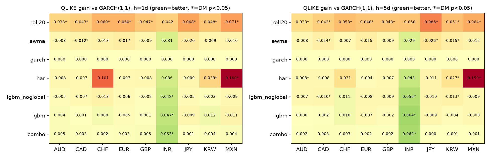
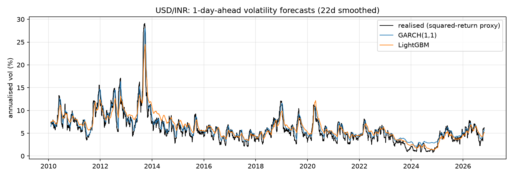

# Volatility forecasting for 9 USD exchange rates: GARCH vs. HAR vs. gradient boosting

**My contribution:** I designed and implemented the whole study (data pipeline, leakage-free features, walk-forward
refitting, GARCH / HAR / LightGBM forecasters, QLIKE loss, Diebold-Mariano tests, figures) as an independent project.

A walk-forward benchmark of volatility forecasters on **EUR, JPY, GBP, CHF, CAD, AUD, INR, MXN and KRW
against the US dollar** (daily data, out-of-sample 2010 -> Oct 2026, about 37,900 forecasts per horizon).
The question: does machine learning beat the textbook GARCH(1,1) at forecasting FX variance, and **is the
difference statistically significant?** Beyond the winner I wanted to know *where* and *why*.



## Models
| Model | Description |
|---|---|
| `roll20` | 20-day rolling mean of squared returns |
| `ewma` | RiskMetrics exponential smoothing (lambda = 0.94) |
| `garch` | GARCH(1,1), zero mean, Gaussian QMLE (`arch` package); **the benchmark** |
| `har` | HAR-style regression (Corsi, 2009) on 1/5/22-day mean squared returns |
| `lgbm_noglobal` | LightGBM (Poisson loss), one model pooled over all currencies, own-currency features only |
| `lgbm` | Same, plus a **global FX-volatility state** (cross-currency average short-term variance) |
| `combo` | Equal-weight average of GARCH, HAR and LightGBM |

## Methodology (designed to avoid the usual mistakes)
- **No look-ahead.** Every feature at day *t* uses only data up to *t*. All models are refit **semi-annually**, using only rows whose targets were fully observed 10 days before the refit date.
- **Targets:** next-day and next-5-day mean variance, proxied by squared returns (only daily closes are available).
- **Loss:** **QLIKE** (log f + v/f), which stays consistent for model ranking even though the variance proxy is noisy (Patton, 2011); MSE is also reported.
- **Scale-free ML:** features and targets are divided by the trailing 1-year mean squared return, so one pooled model serves all currencies.
- **Inference:** Diebold-Mariano tests against GARCH on QLIKE loss differentials with Newey-West errors, per currency, and in two sub-periods (2010-19, 2020+).

## Key results (mean over 9 currencies, 2010-2026)
`QLIKE gain` is the average reduction in QLIKE relative to GARCH (positive = better than GARCH).
`sig. better/worse` counts currencies (out of 9) where the Diebold-Mariano p < 0.05.
`ex-INR` is the same average over the other 8 currencies (`results/gain_ex_inr.csv`).

| Model | h=1 gain | h=1 ex-INR | sig. better / worse | h=5 gain | h=5 ex-INR | sig. better / worse |
|---|---|---|---|---|---|---|
| roll20 | -0.053 | -0.054 | 0 / 8 | -0.053 | -0.053 | 0 / 8 |
| ewma | -0.007 | -0.012 | 0 / 1 | -0.009 | -0.013 | 0 / 3 |
| **garch** (benchmark) | 0 | 0 | - | 0 | 0 | - |
| har | -0.034 | -0.042 | 0 / 2 | -0.024 | -0.032 | 0 / 3 |
| lgbm_noglobal | -0.000 | -0.005 | 1 / 0 | +0.000 | -0.007 | 1 / 2 |
| lgbm | +0.005 | +0.000 | 1 / 0 | +0.005 | -0.002 | 1 / 0 |
| combo | **+0.009** | +0.003 | 1 / 0 | **+0.008** | +0.001 | 1 / 0 |

### What I found
1. **GARCH(1,1) is a hard benchmark.** Simple rolling windows are significantly worse in 8 of 9 currencies; HAR on squared returns is also worse on average.
2. **Almost the entire average gain over GARCH comes from one currency, USD/INR.** Excluding INR, LightGBM is level with GARCH (+0.000 at h=1, -0.002 at h=5) and the combination gains only +0.003 / +0.001 QLIKE. INR alone contributes about +0.047 (LightGBM) and +0.053 (combo) at h=1.
3. **The global-volatility feature matters for the *other* currencies, not for INR.** Without it, the pooled LightGBM is *worse* than GARCH outside INR (-0.005 at h=1, -0.007 at h=5; significantly worse for CAD and KRW at h=5). Adding the cross-currency state brings it back to parity. On INR, however, even the version *without* the global feature beats GARCH significantly (p = 0.040 at h=1, p = 0.004 at h=5), so INR's gain is not explained by the global feature.
4. **USD/INR is where GARCH is weakest.** LightGBM and the combination beat it with p = 0.0125 / 0.0008 at h=1 and p < 0.001 at h=5; only the h=5 results (and the h=1 combo) survive a Bonferroni correction over 9 currencies (threshold 0.0056). A plausible reason is that INR is a managed float whose volatility has regime and intervention dynamics that a single GARCH(1,1) captures poorly. This is a hypothesis, not something I proved; the simple HAR and EWMA models also have positive (but insignificant) point gains on INR, which is consistent with GARCH being a poor fit there.
5. **Averaging forecasts is the most reliable improvement.** `combo` has the lowest mean QLIKE in both horizons and both sub-periods, but the effect size outside INR is small.
6. **Honest caveats:** for 8 of 9 currencies no ML model is significantly better than GARCH. On MSE (dominated by rare spikes) nothing meaningfully beats GARCH: `combo` is within 0.1% of it at h=1 and about 1% worse at h=5, and LightGBM alone is 1-8% worse.



## Reproduce
```bash
python -m venv .venv && source .venv/bin/activate      # Windows: .venv\Scripts\activate
pip install -r requirements.txt
cd src
python run_benchmark.py 2010-01-01      # about 2-3 min; writes tables/figures to ../results
python robustness.py                    # INR-excluded robustness table
```
Data (Federal Reserve H.10 via `github.com/datasets/exchange-rates`) is downloaded automatically on first run.
Results are deterministic (fixed seeds, single-threaded LightGBM). The upstream dataset is updated over time, so
numbers can shift slightly in the third decimal as new days are added; the figures above were produced with data
through 30 Oct 2026.

## Code layout
- `src/data.py`: data loading and returns
- `src/features.py`: causal features, targets, global-volatility state
- `src/forecasters.py`: GARCH, HAR, LightGBM, EWMA, rolling-window forecasters and the refit schedule
- `src/evaluate.py`: QLIKE, MSE, Diebold-Mariano test
- `src/run_benchmark.py`: orchestration, tables, figures
- `src/robustness.py`: gain with and without USD/INR
- `results/`: `summary.csv`, `by_currency.csv`, `dm_vs_garch.csv`, `gain_ex_inr.csv`, `oos_forecasts.csv.gz`, figures

## Things that went wrong (and what I did)
My first HAR regression was floored at a tiny variance (1e-3 of its scale). OLS occasionally produced near-zero
forecasts and QLIKE blew up on those days, making HAR look terrible. I changed the floor to 10% of the trailing-year
mean variance (a standard truncation for OLS variance forecasts) and re-ran everything. The ranking of the other models did not change.
I am reporting this because the floor is a modelling choice that affects the HAR numbers.

I also initially read the small average LightGBM gain as a broad improvement. Splitting results by currency showed it was driven almost entirely by INR, so the conclusions above were revised accordingly.

## Limitations
- **Variance proxy:** squared daily returns are very noisy; intraday realised variance would be better but is not freely available. QLIKE mitigates but does not remove this.
- Daily data are Fed H.10 noon-buying-rate fixings; holidays are skipped, so some "daily" returns span several calendar days.
- Hyper-parameters (LightGBM, refit frequency) were fixed a priori, not tuned. No transaction costs or trading application.
- 9 currencies and 9 hypothesis tests per model: the single significant result (INR) should be read with multiple-testing in mind, and with only one such currency the findings about *why* it differs remain tentative.

## Where to take it next
- Add an LSTM/Transformer forecaster (PyTorch) and compare against LightGBM.
- Use realised variance from intraday data; try GJR-GARCH, GARCH-t, realised-GARCH.
- Add macro features (rate differentials, VIX, oil) to test whether global risk or intervention explains INR.
- Model Confidence Set (Hansen et al., 2011) instead of pairwise tests; a volatility-targeting trading backtest.

## References
Bollerslev (1986), *J. Econometrics*; Corsi (2009), *J. Financial Econometrics*; Patton (2011), *J. Econometrics*; Diebold & Mariano (1995), *JBES*; Ke et al. (2017), LightGBM, NeurIPS.

## License
MIT, see `LICENSE`.
